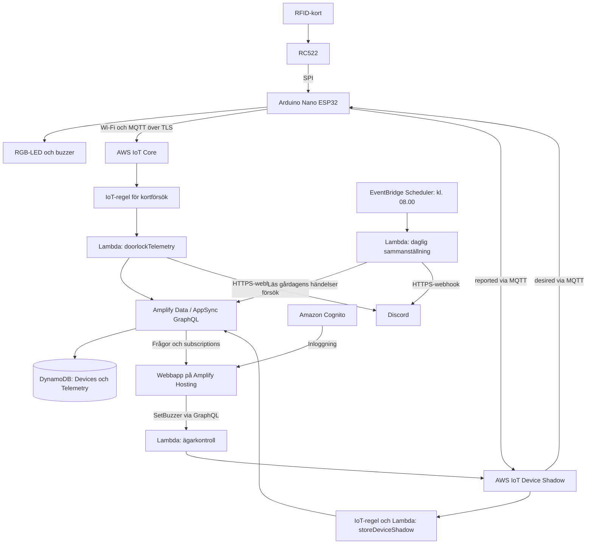
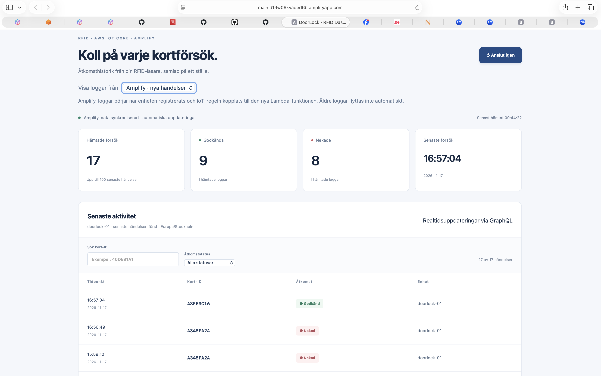
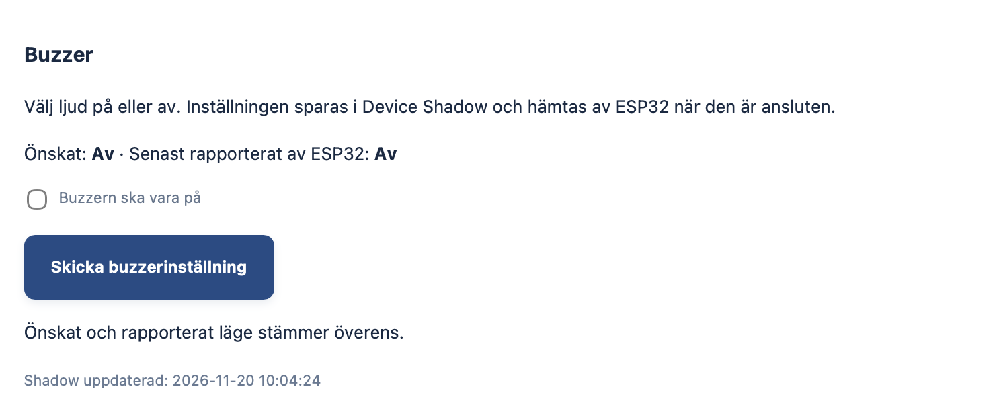

# DoorLock – RFID Dashboard

DoorLock är ett IoT-projekt med en ESP32 och en RFID-läsare. Kortförsök skickas
till AWS och visas på en webbsida med inloggning. RGB-LED och buzzer ger
återkoppling när ett kort godkänns eller nekas.

Webbappen bygger på [kursens React/Vite/Amplify-mall](https://github.com/jh83/amplify-vite-react-template-2025-modified).

## Användningsfall och krav

Projektet är en prototyp för att följa upp kortförsök vid exempelvis ett mindre
arbetsrum. Den tänkta användaren är den som ansvarar för rummet och vill se
vilka kort som har använts, när ett försök nekades och hur många försök som
registrerats under dagen. Kortbeslutet fattas lokalt i ESP32. Prototypen visar
beslutet med ljus och ljud; den driver inget fysiskt dörrlås.

| Krav | Lösning och kontroll |
| --- | --- |
| Läsa ett RFID-kort via ESP32 | RC522 läser UID via SPI. Firmware jämför med lokalt godkända UID. |
| Ge återkoppling vid kortförsök | RGB-LED och buzzer visar godkänt respektive nekat försök. |
| Skicka och lagra händelser i AWS | MQTT/TLS till IoT Core, sedan Lambda och Amplify Data med DynamoDB. |
| Visa historik efter inloggning | Cognito och en Amplify-vy med sökning, statusfilter och statistik. |
| Visa nya försök utan manuell omladdning | GraphQL-subscriptions uppdaterar historiken. |
| Meddela användaren om nekade försök | Lambda skickar en Discord-notis när funktionen är aktiverad. |
| Ge daglig överblick | EventBridge Scheduler startar gårdagens sammanställning kl. 08.00 svensk tid. |
| Ändra buzzerinställningen från webben | Device Shadow lagrar önskat läge och ESP32 rapporterar tillämpat läge. |
| Begränsa åtkomsten till enhetens ägare | Ägarregler för data och ägarkontroll före Shadow-kommandon. Demoanspråk på en fysisk enhet behöver stärkas före fleranvändardrift. |

## Funktioner

- Inloggning med Amazon Cognito.
- Kortförsök i realtid via Amplify Data och GraphQL-subscriptions.
- Sökning på kort-ID och filtrering på godkända eller nekade försök.
- Statistik för de senaste 100 händelserna som visas.
- Enhetsregister med ägare, namn och etiketter.
- Discord-notis vid nekade kortförsök.
- Daglig Discord-sammanställning kl. 08:00 svensk tid efter deployment och aktivering.
- Buzzer på/av via Device Shadow, med önskat och rapporterat läge.

Kortbehörigheter hanteras i ESP32-koden. Enhetsregistreringen på webbsidan
lägger inte till eller spärrar RFID-kort.

## Hårdvara

- Arduino Nano ESP32
- RC522 RFID-läsare
- RGB-LED
- Passiv buzzer

### Den byggda prototypen

Fotona visar Arduino Nano ESP32, RC522, passiv buzzer, RGB-LED med motstånd
och kopplingarna på breadboard. Koppling och pinntabell finns i
[firmwarens README](firmware/DoorLock/README.md).


Röd RGB-LED, det läge som firmware använder vid de första nekade kortförsöken.


Grön RGB-LED, det läge som firmware använder vid ett godkänt kortförsök.
Fotona visar hårdvara och ljusindikering. De verifierar inte i sig vilket kort
som lästs, buzzerljudet eller att samma händelse har nått AWS; detta kontrolleras
med live-test, dashboard och loggar.

## Arkitektur och kommunikation



RC522 är indataenheten och SPI kopplar den till ESP32. ESP32 bearbetar
kortavläsningen och fungerar som länken till molnet via Wi-Fi. Ingen separat
Raspberry Pi eller annan lokal gateway ingår i denna lösning.

En korthändelse innehåller `deviceId`, `eventId`, `uid` och `granted`.
IoT-regeln lägger till mottagningstid. Lambda validerar händelsen och hämtar
ägare och etiketter från enhetsregistret, i stället för att lita på sådana
uppgifter från MQTT-meddelandet.

`Devices` lagrar enhetens ägare och inställningar. `Telemetry` lagrar kort-ID,
åtkomststatus, enhet, händelse-ID och tidsstämpel. Händelser identifieras av
`deviceId` och `eventId`. Indexet `eventsByDeviceAndTime` används för att läsa
en enhets händelser inom ett tidsintervall vid daglig sammanställning.

### Äldre REST-flöde

Det tidigare flödet är separat från Amplify Data:

```text
IoT Core → DoorLockLogs → GetDoorLockLogs → API Gateway
```

REST-valet har tagits bort från den inloggade dashboardens meny. REST-kod finns
kvar för lokal förhandsvisning och de äldre AWS-resurserna är inte avvecklade
av denna ändring. Äldre loggar flyttas inte automatiskt till Amplify Data.
Att ta bort menyvalet stänger inte API:t eller dess IoT-regel.

## Val av lagring och visualisering

| Alternativ | När det passar och projektets val |
| --- | --- |
| DynamoDB | Händelser med kända nycklar och frågor per enhet/tid. Passar kortloggarna och integreras med Amplify Data. Relationer och fria analysfrågor kräver mer planering. |
| Relationsdatabas, exempelvis PostgreSQL | Passar komplexa relationer mellan användare, rum och behörigheter samt SQL-analys. Skulle kräva en annan datamodell och mer backendarbete i detta projekt. |
| S3 | Passar arkiv, exporter och större loggfiler. Objektlagring är ett alternativ för långtidslagring, men används inte här och ersätter inte den nuvarande händelsefrågan direkt. |

Amplify-vyn visar enskilda händelser, filter och summeringar. Discord ger en
andra presentation av insamlad data: direkta varningar och en daglig rapport.
Discord används för notifiering, medan DynamoDB är projektets datalager.
En tidsserie-graf skulle kunna visa utveckling över dagar, men är inte
implementerad.

GraphQL och REST är sätt att komma åt data, inte olika databaser. GraphQL
används i dashboarden för att kombinera hämtning och realtidsuppdateringar.
Det äldre REST-flödet behövde återkommande hämtningar för att visa nya försök.

## Säkerhet och enhetsregistrering

| Del | Skydd i projektet |
| --- | --- |
| ESP32 till AWS | MQTT över TLS med enhetscertifikat, privat nyckel och betrodd rot-CA. IoT-policyn begränsar klient-ID och tillåtna topics för kortförsök och Shadow. |
| Webb och data | Cognito-inloggning och ägarregler med användarens `sub`. Webbanvändaren får läsa sina egna Telemetry-poster; inmatningen sker via backend. |
| Buzzerkommandon | Lambda jämför inloggad användare med enhetens registrerade ägare innan önskat Shadow-läge ändras. |
| Backend | Lambda-funktioner använder IAM. Shadow-åtkomsten begränsas till projektets Thing. |
| Discord | Backend skickar webhook-anrop. URL:en innehåller en hemlig token, ska inte publiceras och skrivs inte ut i funktionsloggarna. |
| Hemligheter | Wi-Fi-lösenord och enhetens privata nyckel ligger i lokal `secrets.h`. Hemlighetsfiler och AWS-inloggningsfiler ignoreras av Git. |

Enheten är manuellt skapad som Thing i IoT Core med ett aktivt certifikat och
en policy. Registreringen i webbappen kopplar sedan `deviceId` till en
inloggad ägare i Amplify. Det är två olika steg: webbregistrering skapar inte
ett nytt certifikat eller bevisar äganderätt till fysisk hårdvara. Automatisk
fleet provisioning är inte implementerad.

Före drift för flera användare behövs ett säkert sätt att tilldela enheter,
exempelvis ett engångsanspråk som kontrolleras i backend. Varje fysisk enhet
bör ha ett eget certifikat som kan spärras separat. Behörigheter får inte
breddas till alla enheter enbart för att förenkla installationen.

Prototypen har säkerhetsbegränsningar:

- Kortbeslutet bygger på UID, som kan kopieras. Lösningen ska inte vara enda
  skyddet för en verklig dörr. Säkrare kortautentisering och en annan
  behörighetsmodell behövs för sådan användning.
- Den äldre REST-routen behöver eget åtkomstskydd eller avvecklas när inga
  klienter behöver den. Cognito-inloggning i webbappen skyddar den inte
  automatiskt. CORS ersätter inte autentisering.
- En dold registreringsknapp hindrar inte i sig självregistrering i Cognito;
  det styrs separat i backend.
- Ett inloggningsfoto visar gränssnittet. Ett separat test med två användare
  behövs för att verifiera att de inte kan läsa varandras data.

## Skalbarhet, leverans och kostnad

Den nuvarande demon använder `doorlock-01`. Vid fler enheter behöver enhets-ID,
IoT-regler, Shadow-behörigheter och webbappens val av enhet anpassas. Delar av
koden är bundna till denna enhet, så 1 000 enheter fungerar inte utan ändringar.
IoT Core, Lambda och DynamoDB kan hantera ökande trafik, men tjänstekvoter,
behörigheter, datamodell och kostnader måste följas upp.

Ett räkneexempel: 100 kortförsök per enhet och dygn ger 3 000 händelser på
30 dagar för en enhet. Med 1 000 enheter blir det 3 miljoner händelser.
Detta är en uppskattning för planering, inte ett genomfört belastningstest.
Shadow-meddelanden, subscriptions och notifieringar tillkommer.

För större drift skulle jag:

- Använda tidsbegränsade frågor och paginering även i dashboarden. Nu
  synkroniserar den alla matchande poster och visar bara de senaste 100.
- Fördela data per enhet och tid samt bevaka ojämn belastning, läskapacitet,
  skrivkapacitet, Lambda-fel och throttling i CloudWatch.
- Införa datalivslängd, exempelvis TTL för äldre händelser och vid behov export
  till S3. Ingen automatisk gallring eller arkivering är implementerad nu.
- Lägga till beständig lokal kö och tydliga kvittenser för loggar. Nu finns
  bara en osänd händelse i RAM och MQTT-publiceringen använder QoS 0.
- Hantera Discords begränsningar med kö, återförsök och vid behov samlade
  notiser. En misslyckad direktnotis försöks inte automatiskt igen nu.
- Mäta trafik och uppskatta kostnader för IoT Core, Lambda, DynamoDB,
  AppSync, Amplify Hosting och CloudWatch med AWS Pricing Calculator.

Den dagliga rapporten läser alla resultatsidor inom gårdagens tidsintervall.
Den har skydd mot vanliga upprepade körningar genom sparat rapportdatum,
men kan ge dubletter om leveransen lyckas före ett fel när datumet sparas,
eller om körningar överlappar. Ingen belastnings- eller kostnadsmätning för
många enheter är genomförd.

## Testresultat och bilder

Kortförsöken nedan registrerades den 17 november 2026. Skärmbilderna togs den
20 november. Resultaten avser dessa tester och garanterar inte att enheten
är uppkopplad just nu.

| Test | Förväntat resultat | Observerat resultat och bevis |
| --- | --- | --- |
| Inloggningssida | Inloggning visas för utloggad användare. | Inloggningsformuläret visas. Bilden är inte ett test av alla API-behörigheter. |
| Godkänt och nekat kort | Båda typerna lagras och kan visas i dashboarden. | 17 försök: 9 godkända och 8 nekade. UID, enhet och tid visas. |
| Realtidsuppdatering | Nytt kortförsök visas utan manuell omladdning. | Kontrollerat vid tidigare live-test. En stillbild visar historiken men bevisar inte uppdateringsförloppet. |
| Discord vid nekat kort | Ett meddelande skickas för nekat försök när notifiering är aktiverad. | Discord visar kort-ID, enhet och tidsstämpel för nekade försök. |
| Daglig rapport | Kl. 08.00 levereras föregående dags antal. | Den 18 november kl. 08.00 levererades rapporten för den 17 november med 17 försök, 9 godkända och 8 nekade. Det stämmer med dashboarden. |
| Rapport utan kortförsök | Dagen summeras med nollor. | Den 19 november kl. 08.00 levererades rapporten för den 18 november med 0 försök. |
| Shadow, bekräftat läge | Önskat och rapporterat läge överensstämmer efter tillämpning. | På/På visas med Shadow-tid 17 november kl. 16.56.17. Ljudets funktion har också kontrollerats vid tidigare hårdvarutest. |
| Shadow, ny ändring | Önskat läge kan skilja sig från senast rapporterat tills enheten bekräftat. | Den 20 november kl. 09.57.38 visas Av/På. Bilden visar vänteläget före bekräftelsen nedan. |
| Shadow, bekräftat Av | ESP32 rapporterar Av efter ändringen. | Den 20 november kl. 10.04.24 visas Av/Av och meddelandet att önskat och rapporterat läge stämmer överens. Bilden visar rapporterad inställning; den verifierar inte i sig det fysiska ljudet. |

### Dashboard



### Inloggning


### Discord-notiser och automatiska rapporter


### Device Shadow: önskat och rapporterat På


### Device Shadow: ändring som väntar på bekräftelse


### Device Shadow: bekräftat Av



För en ny redovisning: starta ESP32, kontrollera AWS-anslutningen i Serial
Monitor, visa ett godkänt och ett nekat kort och följ samma händelser i
Amplify och Discord. Ändra sedan buzzern och kontrollera både rapporterat
läge och fysiskt ljud. Demonstrera även att ett önskat läge som skickas när
enheten är avstängd hämtas efter återanslutning. Av/Av har bekräftats i skärmbilden ovan. Vid ett nytt test ska även
det fysiska ljudet kontrolleras. Fotona i hårdvaruavsnittet kompletterar dessa skärmbilder med den byggda
prototypen och dess ljusindikering.

## Köra lokalt

Använd Node.js 24 eller senare.

```sh
npm install
npm run dev
```

Öppna [localhost:5173](http://localhost:5173).

För inloggning och Amplify Data behövs projektets genererade
`amplify_outputs.json` bredvid `package.json`. Hämta filen från Amplify efter
deployment, eller kör följande med en AWS-inloggad CLI:

```sh
npx ampx generate outputs --app-id DITT_APP_ID --branch main
```

Starta om Vite när filen är på plats. Utan filen visas en lokal förhandsvisning
som använder REST-API:et. Produktionsversionen kräver auth-konfiguration.

```sh
npm test       # Tester
npm run build # Produktionsbygge
```

## Deployment

Projektet publiceras med AWS Amplify i `eu-north-1`. `amplify.yml` deployar
backend, genererar konfigurationen och bygger webbappen till `dist`.

Registrera `doorlock-01` på webbsidan och koppla IoT-regeln till den genererade
`doorlockTelemetry`-funktionen. Regeln använder följande SQL:

```sql
SELECT topic(2) AS deviceId, eventId, uid, granted,
       timestamp() AS timestamp
FROM 'doorlock/doorlock-01/events'
```

## Discord-notiser

Ange en Discord-webhook under **Enhet och notifieringar** och välj vilka
notiser som ska skickas. Direkta notiser och morgonrapporten aktiveras separat.
Webhook-URL:en innehåller en hemlig token och ska inte läggas i Git.

`doorlockDailySummary` körs av EventBridge Scheduler kl. 08:00 i tidszonen
`Europe/Stockholm`. Rapporten räknar gårdagens Amplify-händelser för enheten
och dess ägare. Sommar- och vintertid hanteras, och alla sidor av resultatet
hämtas. Dagar utan kortförsök ger en rapport med nollor.

Ett privat Lambda-testevent med `{}` skickar en riktig rapport för gårdagen.
Loggarna i CloudWatch visar `Daily summary delivered` och `Daily summary complete`.
Senaste levererade datum sparas på enheten. En dublett kan förekomma om
leveransen lyckas men datumet inte sparas, eller vid samtidiga körningar.

## Device Shadow

Under enhetsinställningarna kan ägaren begära att buzzern slås på eller av.
`SetBuzzer` kontrollerar enhetens ägare och uppdaterar `desired.buzzerEnabled`
i dess klassiska Device Shadow. ESP32 tillämpar värdet och skickar `reported`.
En IoT-regel och `storeDeviceShadow` speglar Shadow-status till Amplify så att
webbsidan kan visa både önskat och senast rapporterat läge.

Firmware finns i `firmware/DoorLock`. Arduino-biblioteken MFRC522, PubSubClient
och ArduinoJson behövs. `DeviceShadow.h` ska ligga bredvid `DoorLock.ino` och
`pins.h`. Kopiera `secrets.example.h` till en lokal `secrets.h` och fyll i egna
uppgifter om projektet installeras på en ny dator.

Utöka certifikatets IoT-policy enligt `firmware/doorlock-iot-policy.json` innan
firmware laddas upp. Byt REGION och ACCOUNT_ID till det egna kontots värden.
Policyn behåller publicering av kortförsök och tillåter enbart de Shadow-topics
som enheten använder. Backend skapar Shadow-regeln och Lambda-behörigheterna.

Buzzerinställningen sparas lokalt i ESP32 och läses även efter omstart.
Vid MQTT-återanslutning hämtas aktuellt önskat läge från AWS. En begäran kan
ligga kvar i molnet medan enheten är frånkopplad; senast rapporterat läge
är inte samma sak som aktuell online-status. RGB och kortbehörigheter påverkas
inte av buzzerinställningen.

## Begränsningar

- Enhetsregistreringen är anpassad för projektets demo. En tjänst med flera
  användare behöver även kontrollera vem som får registrera varje fysisk enhet.
- Realtidsvyn synkroniserar alla matchande Amplify-poster och visar de senaste
  100. Vid större datamängder behöver även vyn använda begränsade tidsfrågor.
- Det äldre REST-API:et behöver separat åtkomstskydd och CORS-konfiguration.
  Cognito-inloggningen i webbsidan skyddar inte automatiskt REST-routen.
- Registreringsknappen för användarkonton är dold. Självregistrering styrs
  separat i Cognito.
- Online/offline-status är ännu inte implementerad.
- Wi-Fi ställs in i firmware. Captive portal och automatiskt val mellan flera
  sparade Wi-Fi-nät är inte implementerade.

AWS-nycklar, certifikat och lösenord ska hållas utanför Git. Inställningar med
prefixet `VITE_` är synliga i webbläsaren och får inte innehålla hemligheter.

## Underlag för presentation

- Visa användningsfallet, kravtabellen och arkitekturen.
- Demonstrera RFID, lokal återkoppling, Amplify-historik, Discord och Shadow.
- Förklara val av lagring, skillnaden mellan historik och notifieringar samt
  säkerhet, skalbarhet och kända begränsningar.
- Ha Arduino IDE, bibliotek, USB-kabel och en fungerande nätanslutning redo
  för att kunna konfigurera och ladda upp firmware på plats.

Inga SMHI-hämtningar eller SMHI-schemalagda jobb finns i den aktuella
Amplify-koden. Schemat för DoorLocks morgonrapport används av projektet.
