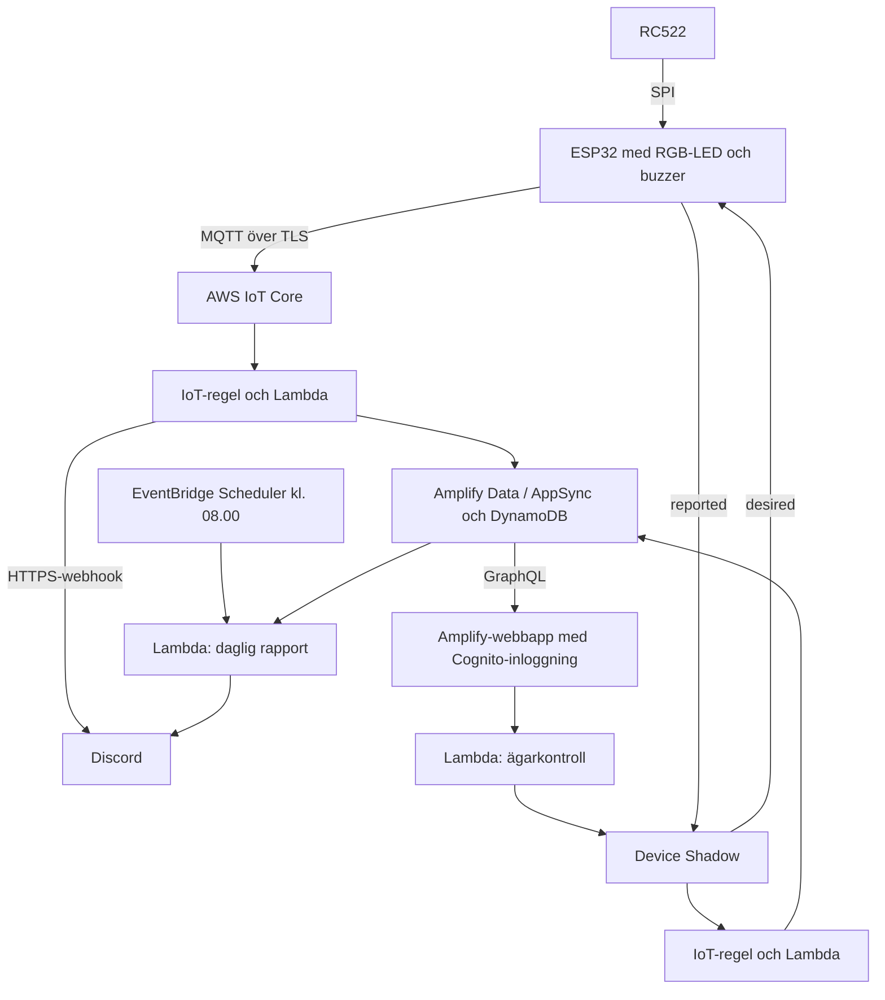
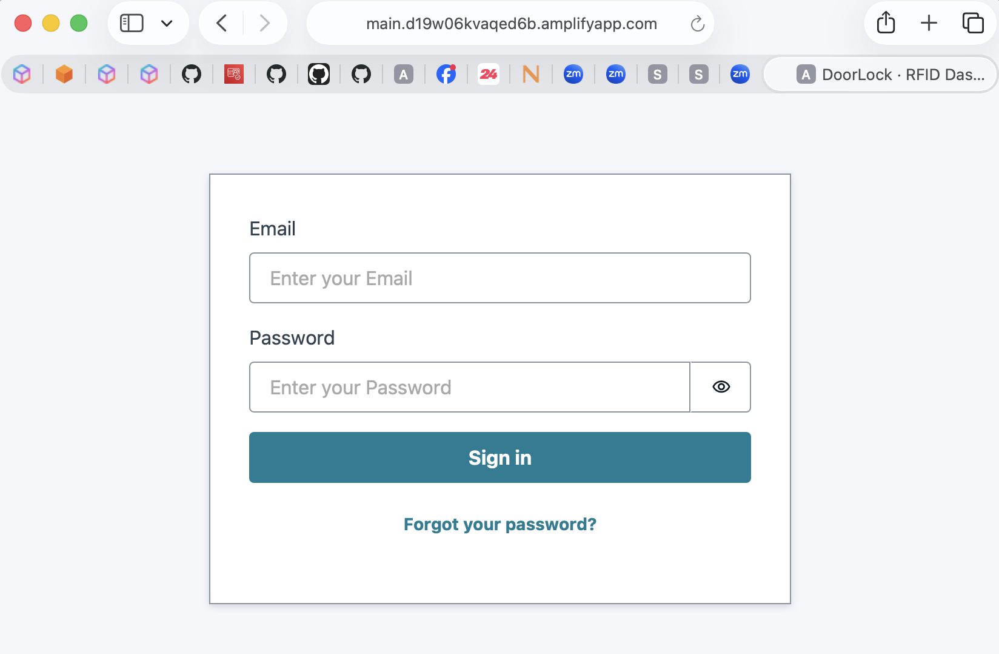
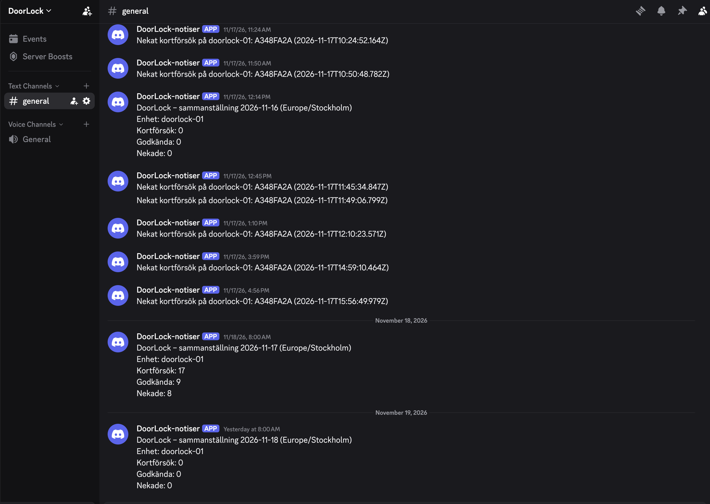
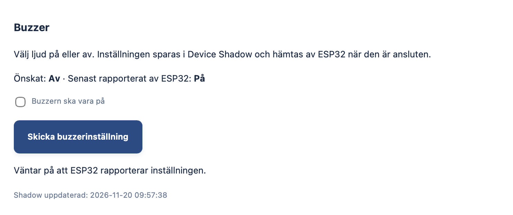
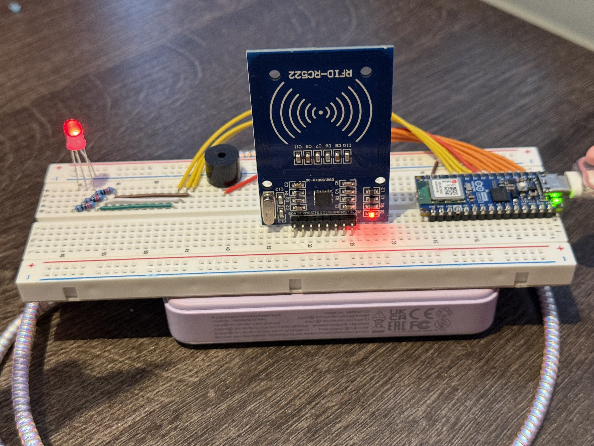
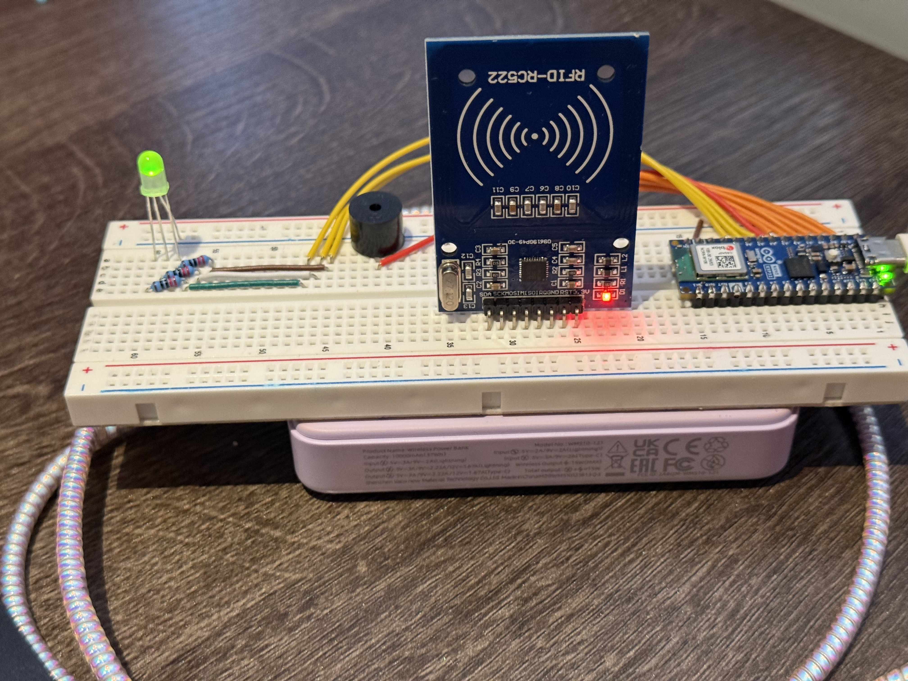

# DoorLock – RFID Dashboard

En prototyp för den som ansvarar för ett mindre arbetsrum och vill följa upp
kortförsök och få varningar vid nekad åtkomst. Arduino Nano ESP32 och RC522
läser kort; RGB-LED och buzzer ger återkoppling. Inget fysiskt dörrlås styrs.

Webbappen bygger på [kursens Amplify-mall](https://github.com/jh83/amplify-vite-react-template-2025-modified).

## Krav och lösning

| Krav | Genomförande |
| --- | --- |
| Inhämta data via ESP32 | RC522 läser kortets UID via SPI till ESP32. Godkända UID finns i firmware. |
| Skicka data till AWS | ESP32 skickar kortförsök via Wi-Fi och MQTT/TLS till AWS IoT Core. |
| Lagra i databas | IoT-regel och Lambda sparar händelser i DynamoDB via Amplify Data. |
| Använda externt API | Discord-webhook tar emot nekade försök och gårdagens rapport kl. 08.00 svensk tid. |
| Visualisera data | Amplify visar historik, filter och statistik med realtidsuppdateringar via GraphQL. Discord visar varningar och rapporter. |
| Dokumentera i GitHub | README, testbilder, backend och [firmware med kopplingstabell](firmware/DoorLock/README.md). |
| Styra en inställning från molnet | Device Shadow hanterar önskat och rapporterat buzzerläge. |

### Arkitektur och kommunikation

ESP32 är länken mellan RFID-läsaren och molnet. Ingen separat lokal gateway
ingår. `Devices` lagrar ägare och inställningar; `Telemetry` lagrar enhet,
händelse-ID, kort-ID, åtkomststatus och tid.

### IoT-säkerhet

Enhetscertifikat och TLS används till AWS. IoT-policyn begränsar klient-ID och
topics. Cognito och ägarregler begränsar Amplify-data; Lambda kontrollerar
ägaren före buzzerkommandon. Privata nycklar, lösenord och webhook-token hålls
utanför Git. Thing och certifikat skapas manuellt; webbregistreringen kopplar
enheten till användaren.

Begränsningar: UID kan kopieras, och registreringen behöver säkrare bevis på
ägande före fleranvändardrift. Det äldre REST-API:t finns kvar separat och
behöver eget åtkomstskydd eller avveckling; att ta bort menyvalet stänger inte
API:t. Åtkomst mellan två användare är inte verifierad med testbilderna.

### Val av lagring och visualisering

DynamoDB passar händelser som hämtas per enhet och tid. PostgreSQL skulle passa
mer komplexa relationer och SQL-analys; S3 skulle passa arkiv och exporter.
De två senare används inte här. Amplify ger sökbar historik, medan Discord
ger direkta notiser och dagliga summeringar. GraphQL används för dataåtkomst
och realtidsuppdateringar.

### Skalbarhet och begränsningar

Om jag skulle utöka systemet från en enhet till 1 000 enheter skulle jag fortsätta använda AWS eftersom molntjänsterna har stöd för skalbarhet.

Däremot skulle jag behöva förbättra min kod. Varje enhet skulle behöva ett unikt enhets-ID och ett eget certifikat. Jag skulle också behöva optimera hur information hämtas från databasen för att undvika onödiga kostnader och långsamma laddningstider.

## Tester och bilder

### Inloggning

### Discord-notiser och morgonrapport

Nekade försök skickas som notiser. Den 18 november kl. 08.00 levererades
rapporten för den 17 november med samma 17 försök som dashboarden. Nästa dag
levererades en rapport med noll försök.

### Device Shadow: På → Av

Bekräftat På/På den 17 november kl. 16.56.17.

Ändringen till Av väntade på bekräftelse den 20 november kl. 09.57.38.

ESP32 bekräftade Av den 20 november kl. 10.04.24: önskat och rapporterat läge stämmer överens.

### Den byggda hårdvaran

Arduino Nano ESP32, RC522, RGB-LED, motstånd och passiv buzzer på breadboard.
Rött används vid de första nekade försöken; grönt vid ett godkänt försök.
Fotona visar kopplingen och ljusindikeringen.

